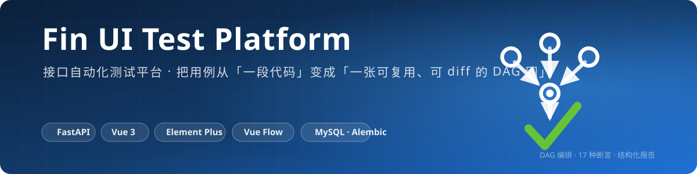

<p align="center">
  
</p>

# Fin UI Test Platform

> 把 UI 用例从"一段代码"变成"一张可复用、可 diff 的 DAG 图"。

[](https://fastapi.tiangolo.com/)
[](https://playwright.dev/)
[](https://vuejs.org/)
[](https://element-plus.org/)
[](https://vueflow.dev/)
[](#testing)
[](../LICENSE)

## Features

- **DAG 可视化编排** — 拖拽 UI 操作节点 + 连线描述执行顺序，自动布局 / 新节点防重叠 / minimap
- **60+ 浏览器动作** — goto / click / fill / hover / select / 断言类动作 / 页面级组合动作（steps），每步产出结构化 facts（url / title / text…）
- **元素库沉淀** — 多策略 + 兜底链定位（test_id / label / text / role / xpath 优先级可配），元素按名引用，内联策略可随用随配；来源项目 locator JSON 一键迁移
- **`${}` 表达式** — UI 步骤值自由文本：`${name}` 跨节点平铺引用、`${n1.var}` 命名空间精确引用、`${now(format='%Y-%m-%d')}` 内置函数、`${db.query_one('SELECT …')}` SQL 取数（与 API 平台函数注册表同源）
- **提取 + 17 种断言** — 页面事实 JSONPath 提取入节点命名空间；JSONPath / 耗时 / DB 查询 / DB 交叉校验断言复用共享引擎，DB 断言支持重试应对异步落库
- **失败取证** — UI 节点失败自动截图入文件中心（按执行人归属），事件携带 `step_kind=ui` 与 `screenshot_file_id`
- **测试套件** — 跨系统用例链：串行执行多个成员用例（可跨项目、逐成员绑环境），共享变量白名单把上游产出注入下游
- **结构化报告** — 每步 facts / 断言 / 耗时全量落库，响应体 JSON 可展开收起；后端导出 CSV（Excel 兼容）/ HTML（可打印 PDF）
- **工程化** — JWT 鉴权 + admin/member 角色 + 操作审计 + Alembic 迁移 + 亮暗主题 + 标签页 + 命令面板（Ctrl+K）

> 本平台由 fin-api-test 的 DAG 编排核心派生：执行器 / 变量注册表 / 断言引擎 / 报告链路与 API 平台同源；接口注册与数据集入参两个 API 工作面已裁撤（历史 API 节点仍可执行回放）。

## Quick Start

```bash
# 1. 建库
mysql -u root -p -e "CREATE DATABASE fin_ui_test DEFAULT CHARSET utf8mb4"

# 2. 配置后端
cd platform/backend
cp .env.example .env   # 填写 DB_PASSWORD 与 JWT_SECRET_KEY
pip install -r requirements.txt
python -m playwright install chromium   # 浏览器内核
python -m uvicorn app.main:app --port 8000   # 自动迁移建表 + 创建 admin 账号

# 3. 启动前端
cd platform/frontend
npm install && npm run dev
```

访问 http://localhost:5173 · 默认账号 `admin` / `admin123`（首登强制改密）· Swagger http://127.0.0.1:8000/docs

## Architecture

```
┌─────────────────────────────────────────────────┐
│        前端 Vue3 + Element Plus + Vue Flow        │
│  views (14 页) ← composables                      │
│  useExecutionRunner / useGroupTree / useRefGroups │
│       │                    ↑ 复用轮询/分组/引用图   │
│       │ api/index.ts ← types/api.gen.ts (OpenAPI) │
└──────────────────────────┬──────────────────────┘
                           │ /api
┌──────────────────────────▼──────────────────────┐
│                 路由层 routers/                   │
│  HTTP 语义 + 鉴权 + 审计日志（薄层，无业务逻辑）      │
├─────────────────────────────────────────────────┤
│       数据访问层 crud/（按域拆分，显式 re-export）   │
│  users · auth · executions · versions · legacy   │
├─────────────────────────────────────────────────┤
│                 服务层 services/                   │
│  execution_launcher · runtime · ui_runtime       │
│  scheduler · suite_executor · report_export      │
│  replay_service · notifier · files               │
└──────────────────────────┬──────────────────────┘
                           │ 线程池异步执行
┌──────────────────────────▼──────────────────────┐
│              DAG 执行引擎 engine/                  │
│  topo_order 唯一实现 → step_type 分发              │
│  ui: ui_runtime 动作链 → facts → 提取/断言/截图     │
│  api: prepare_request → 请求 → 提取 → 断言（历史）  │
│  events.py: StepResult → ExecutionSink 接缝       │
│  variables.py: 节点命名空间变量注册表                │
└──────────────────────────┬──────────────────────┘
                ┌─────────┴─────────┐
                ▼                   ▼
          Playwright           MySQL Client
          浏览器动作/截图        DB 取数与交叉校验
```

**分层规约**（由测试守卫）：

- 路由层不内联 ORM，业务不变量下沉 `crud/` 域模块（如登录锁定策略在 `crud/auth.py`）
- 执行编排（建记录→提交→聚合通知）只有一份实现 `services/execution_launcher.py`，
  单次/批量/定时三入口共用
- UI 节点提取/断言复用 DAG 执行器 `_extract_and_assert` 收口（与 API 节点同一条管线，
  facts 即 response_body）
- UI 步骤表达式求值单点 `engine/expression.py`（函数集复用 `engine/functions.py` 注册表，
  与四来源参数模型同源）
- Kahn 拓扑排序单点 `engine/topo.py`；企微通知门控单点 `services/notifier.py`
- 执行引擎产出 `StepResult` 事件经 `ExecutionSink` 落库（`DbSink`），
  引擎不反向 import 路由层 —— `test_engine_does_not_import_routers` 守卫
- 报告导出为后端纯函数 `services/report_export.py`，`GET /reports/executions/{id}/export?format=csv|html`

## 前后端类型单一事实来源

后端 Pydantic schema → `npm run gen:api` 生成 `src/types/api.gen.ts` 供前端消费，字段漂移在 vue-tsc 编译期暴露。
错误契约显式化：拦截器把一切失败规整为 `ApiError`（message 必为后端 detail），视图 catch 只读 `e.message`。

## Testing

```bash
cd platform/backend
python -m pytest tests/ -q          # 870 passed
python -m ruff check --select F platform/backend   # 与 CI backend-lint 同口径
cd ../frontend && npx vue-tsc --noEmit             # 与 CI frontend-lint 同口径
cd ../frontend && npm test -- --run                # vitest 148 passed
```

测试布局（fake-db 单测，不依赖真实 MySQL、不拉起浏览器）：

| 域 | 文件 | 覆盖 |
|---|---|---|
| 执行编排 | `test_execution_launcher.py` | 展开→提交→聚合编排 + ExecutionSpec 组装 |
| 执行引擎 | `test_execute_node.py` | 单节点管线 + 分层守卫 |
| UI 集成 | `test_ui_integration.py` | 定位策略链 / ui_runtime 纯函数 / step_type=ui 分发（facts→提取→断言→截图事件全链路，替身不拉浏览器） |
| UI 动作 | `test_ui_actions.py` | 动作词表 / CaseNodeConfig 的 step_type+ui_params 结构写回 |
| 请求发送 | `test_request_sender.py` | 分发/multipart/异常分类 + 防平行实现守卫 |
| 通知 | `test_notifier.py` | 门控开关/单条与聚合通知/环境查无 |
| 拓扑排序 | `test_dag_executor_topo.py` | Kahn 排序唯一实现 |
| 测试套件 | `test_suite_executor.py` | 白名单注入/逐行配对/行与整体阻断/嵌套与悬空（10 用例） |
| 变量注册表 | `test_variables.py` | 命名空间隔离/引用取不到即失败/order_params 参数拓扑与环检测 |
| 保存校验 | `test_validation.py` | 悬空引用/未知节点与函数/依赖环拒绝保存并定位参数 |
| 续跑与重放 | `test_{resume_executor,orchestration_fingerprint,report_context}.py` | 结构指纹锁定/续跑起点定位/报告虚拟上下文 seed 还原 |
| crud 域 | `test_{users,auth,executions}_domain.py` | 登录锁定/首管理员/最后管理员保护等 |
| 报告导出 | `test_report_export.py` | CSV/HTML 契约 |
| schema | `test_audit_mixin.py` | 审计字段继承 + Out 契约 |

## Tech Stack

FastAPI · SQLAlchemy 2.0 · Pydantic 2 · Alembic · PyMySQL · Playwright ｜ Vue 3.5 · Element Plus · Vue Flow · Pinia · Vite · openapi-typescript

## FAQ

- **uvicorn 无 access log** — `alembic/env.py` 的 `fileConfig()` 需设 `disable_existing_loggers=False`
- **路由切换后页面空白** — 顶层 `<router-view>` 不可加 `:key="route.path"`，会触发 MainLayout 重挂载丢状态
- **UI 节点定位不到元素** — 优先在元素库配多策略兜底链；`for` 语义按 label[for=X] 后兄弟容器首个输入件定位（被测系统 for 值非真实 DOM id，[id=X] 直查定位不到——实证）

## License

[MIT](../LICENSE)
